

# Егор Ангелов · DIBERLOG

### Frontend / Full-Stack · AI-инструменты · Субагенты для бизнеса

Создаю сайты, интерфейсы и прикладные AI-инструменты. Специализируюсь на внедрении AI и работе с субагентами в бизнес-процессах: от постановки задачи и распределения ролей до интеграции с рабочими инструментами и проверки результата.

**[Проекты](#избранные-проекты) · [Все репозитории](#каталог-публичных-репозиториев) · [Связаться](#контакты)**

## Обо мне

Работаю на стыке веб-разработки, автоматизации и искусственного интеллекта. Мне интересны продукты, где понятный интерфейс помогает решить конкретную задачу: изучить тему, организовать работу, обработать документ или сократить повторяющиеся действия.

Развиваю собственные образовательные проекты, игры и настольные приложения. Уделяю внимание архитектуре, визуальной иерархии и возможности поддерживать продукт после запуска.

## AI и субагенты в бизнес-процессах

Моя специализация — внедрение AI-помощников и организация совместной работы субагентов в рабочих процессах компании.

- Разбор процесса: какие действия автоматизировать, какие данные нужны и где человек принимает решение.
- Распределение ролей между субагентами: анализ исходных данных, подготовка результата, проверка и доработка.
- Сценарии для документов, писем, отчётов, встреч и внутренних рабочих задач.
- Интеграция с API, локальными моделями и прикладными инструментами.
- Контроль результата: редактирование, подтверждение действий и сохранение истории работы.

Практический пример — **JARVIS · ALTRON**: настольный помощник с голосом, чатом и экспериментальным разделом офисных агентов. Возможности и ограничения конкретной версии описаны в репозитории проекта.

## С чем могу помочь

- Внедрение AI и субагентов в бизнес-процессы; прототипирование и интеграция рабочих сценариев.
- Сайты, лендинги, продуктовые страницы, кабинеты и внутренние сервисы.
- Frontend по макету или ТЗ; full-stack приложения с API и базами данных.
- WordPress / WooCommerce: кастомные темы, каталоги и формы заявок.
- Образовательные интерфейсы, интерактивные карты и визуализация знаний.
- Доработка существующих продуктов: UX, структура, автоматизация и поддерживаемый код.

## Технологии

| Направление | Стек |
| --- | --- |
| Frontend | HTML, CSS, JavaScript, TypeScript, React, Vue, Nuxt, Svelte, Vite |
| Backend / CMS | Node.js, Express, PHP, WordPress, WooCommerce |
| AI / Автоматизация | Python, OpenAI API, Ollama, OCR, субагенты, интеграции API |
| Desktop | Rust, Tauri, голосовые команды, TTS |
| Интерактив / Данные | Three.js, WebGL, Canvas, MongoDB, SQLite, MySQL |
| Разработка | Git, GitHub, GitHub Actions |

## Избранные проекты

### [JARVIS · ALTRON](https://github.com/DIBERLOG/JARVIS_ALTRON)

<!-- CARD:START -->
[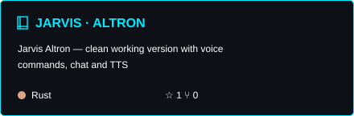](https://github.com/DIBERLOG/JARVIS_ALTRON)
<!-- CARD:END -->

Настольный помощник: голосовые команды, чат с локальными и облачными моделями, личный центр и работа с документами. В экспериментальном разделе «Агенты · LAB» задачи распределяются между помощниками для подготовки и проверки писем, документов и отчётов.

**Rust · Tauri · Svelte · AI · субагенты**

[Релизы](https://github.com/DIBERLOG/JARVIS_ALTRON/releases) · [Инструкция](https://github.com/DIBERLOG/JARVIS_ALTRON/blob/master/docs/INSTALL.md)

Развиваю проект на основе Priler/jarvis; авторство исходного проекта и условия использования указаны в репозитории. Офисные агенты и перенос на другие платформы имеют экспериментальный статус.

### [Лаборатория Менделеева](https://github.com/DIBERLOG/mendeleev-lab.ru)

<!-- CARD:START -->
[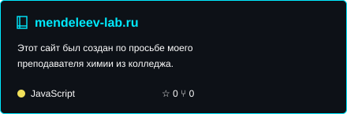](https://github.com/DIBERLOG/mendeleev-lab.ru)
<!-- CARD:END -->

Интерактивная образовательная платформа на основе таблицы Менделеева. Проект объединяет навигацию по элементам, структуру данных и наглядный интерфейс для изучения химии.

### [Map Fiziki](https://github.com/DIBERLOG/map_fiziki)

<!-- CARD:START -->
[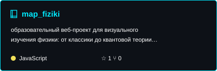](https://github.com/DIBERLOG/map_fiziki)
<!-- CARD:END -->

Образовательная карта физики: темы, связи и визуальная навигация по знаниям. Кейс про работу со сложной информацией и образовательный UX. [Сайт Phys-Lab](https://phys-lab.ru).

### [Matreshka Master](https://github.com/DIBERLOG/matreshka-master-wordpress)

<!-- CARD:START -->
[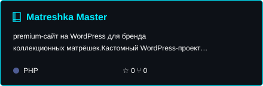](https://github.com/DIBERLOG/matreshka-master-wordpress)
<!-- CARD:END -->

WordPress / WooCommerce сайт-каталог коллекционных матрёшек: кастомная тема, редактируемая главная страница, каталог и формы заявок.

### [MongoDB Practice Hub](https://github.com/DIBERLOG/MongoDB-Practice-Hub)

<!-- CARD:START -->
[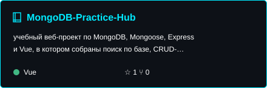](https://github.com/DIBERLOG/MongoDB-Practice-Hub)
<!-- CARD:END -->

Учебное full-stack приложение на Vue, Express, Mongoose и MongoDB: поиск, CRUD, фильтрация, сортировка, валидация и связанные коллекции.

### [Vue Work Lab](https://github.com/DIBERLOG/work_project)

<!-- CARD:START -->
[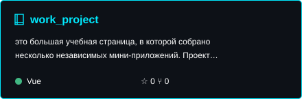](https://github.com/DIBERLOG/work_project)
<!-- CARD:END -->

Набор интерактивных учебных мини-приложений: компоненты, состояние, формы и пользовательские сценарии в едином интерфейсе Vue.

### [Sait Proect](https://github.com/DIBERLOG/sait-proect)

<!-- CARD:START -->
[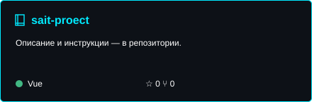](https://github.com/DIBERLOG/sait-proect)
<!-- CARD:END -->

Учебные практики Nuxt и Vue: API, реактивный каталог iPhone, социальная сеть, маршрутизация и режимы SSR / CSR / SWR.

### [Urban Blueprint City Techplan](https://github.com/DIBERLOG/urban-blueprint_city-techplan)

<!-- CARD:START -->
[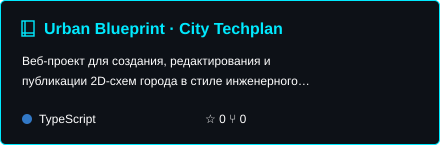](https://github.com/DIBERLOG/urban-blueprint_city-techplan)
<!-- CARD:END -->

Создание, редактирование и публикация 2D-схем города: зоны, дороги, здания и публичные карты.

## AI-инструменты и игры

| Проект | Что внутри |
| --- | --- |
| [AI Screenshot Assistant](https://github.com/DIBERLOG/AI-Screenshot-Assistant-Ultimate-Multi-Provider-Edition) | OCR, анализ и перевод текста со скриншотов, подключение нескольких AI-провайдеров. |
| [Manor Lords AI Agent](https://github.com/DIBERLOG/manor-lords-ai) | Настольный агент с чтением HUD, Ollama и автоматизацией действий. **В разработке.** |
| [Earthlight VS Aliens](https://github.com/DIBERLOG/Earthlight-VS-Aliens-Attacks) | Аркадная игра про противостояние землян и пришельцев на Python. |
| [Minecraft Project](https://github.com/DIBERLOG/the-minecraft-project) | Собственный игровой проект по мотивам Minecraft на Python. |
| [New Year's Gift Collection](https://github.com/DIBERLOG/New-Year-s-Gift-collection) | Новогодняя аркада со сбором подарков и ограничением времени. |

## Каталог публичных репозиториев

Каталог обновляется автоматически из GitHub. Форки отмечены отдельно; новые публичные проекты добавляются при следующем обновлении. Инструкции запуска и условия использования находятся в каждом репозитории.

<!-- PROJECTS:START -->
[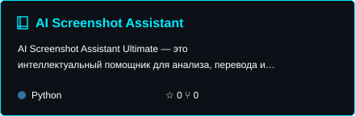](https://github.com/DIBERLOG/AI-Screenshot-Assistant-Ultimate-Multi-Provider-Edition)
[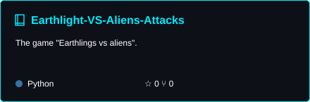](https://github.com/DIBERLOG/Earthlight-VS-Aliens-Attacks)

[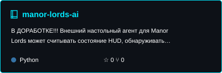](https://github.com/DIBERLOG/manor-lords-ai)

[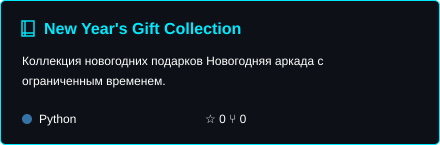](https://github.com/DIBERLOG/New-Year-s-Gift-collection)

[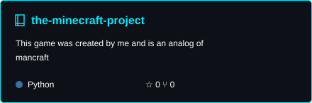](https://github.com/DIBERLOG/the-minecraft-project)

[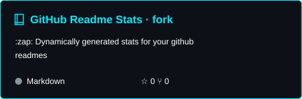](https://github.com/DIBERLOG/github-readme-stats-diberlog)
<!-- PROJECTS:END -->

## GitHub Статистика

<!-- STATS:START -->
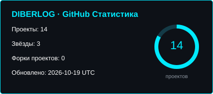
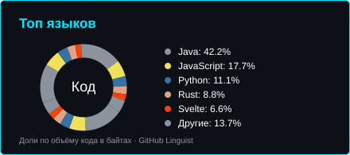

Данные на 2026-10-13 (UTC). Считаются публичные проекты портфолио без форков. Доли языков рассчитываются по объёму кода в байтах из GitHub Linguist.
<!-- STATS:END -->

Карточка хранится в этом репозитории и обновляется через GitHub Actions. [История обновлений](https://github.com/DIBERLOG/About-me/actions/workflows/portfolio.yml) · [Активность на GitHub](https://github.com/DIBERLOG?tab=overview).

## Сотрудничество

Открыт к проектной и фриланс-работе: внедрение AI и субагентов, frontend / full-stack, MVP, внутренние инструменты, образовательные проекты и доработка существующих сайтов.

В работе для меня важны понятная задача, удобный интерфейс, поддерживаемый код и проверяемый результат.

## Контакты

- **GitHub:** [DIBERLOG](https://github.com/DIBERLOG)
- **Email:** [minectur@gmail.com](mailto:minectur@gmail.com)
- **Discord:** `diberloger`
- **Сайт:** [phys-lab.ru](https://phys-lab.ru)
- **Ошибки в портфолио и предложения:** [Issues](https://github.com/DIBERLOG/About-me/issues/new/choose)

---

[Как обновляется портфолио](CONTRIBUTING.md)
